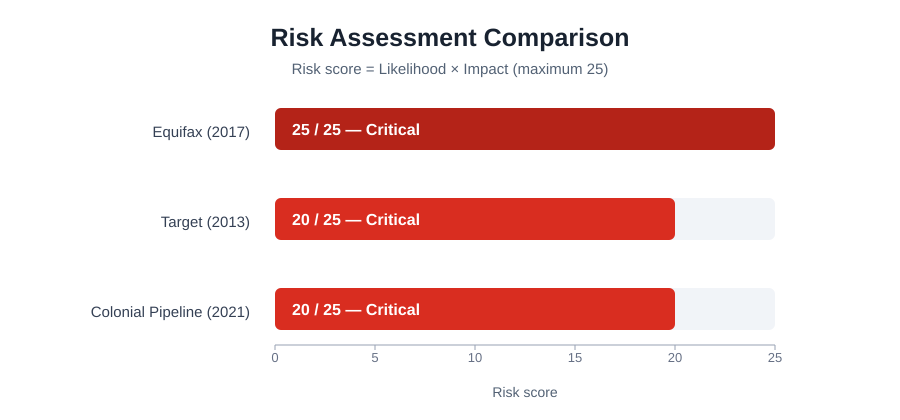

# Vulnerability, threat, and risk assessment

| Breach | Vulnerability / Weakness | Threat | Likelihood | Impact | Risk Score | Rationale / Source |
|---|---|---|---:|---:|---:|---|
| **Equifax (2017)** | Unpatched Apache Struts vulnerability, unencrypted credentials, insufficient network segmentation and ineffective vulnerability monitoring. | External cybercriminals exploiting a known web application vulnerability to gain unauthorized access and steal sensitive personal information. | 5 | 5 | **25 - Critical** | The vulnerability was publicly known and a patch was available, but the affected system remained unpatched. Attackers accessed multiple databases and stole personal information belonging to approximately 145.5 million individuals. |
| **Target (2013)** | Weak third-party vendor access controls, insufficient network segmentation, excessive access privileges and failure to respond effectively to security alerts. | External attackers using compromised vendor credentials to access Target's network, deploy POS malware and steal payment card information. | 4 | 5 | **20 - Critical** | Attackers used vendor credentials to enter Target's network and reach POS systems. Security alerts were generated but not acted upon effectively. Approximately 40 million payment card accounts were affected. |
| **Colonial Pipeline (2021)** | Legacy VPN account remained active, compromised credentials and lack of multi-factor authentication on the legacy VPN profile. | DarkSide ransomware operators using compromised VPN credentials to gain unauthorized network access, steal company data and deploy ransomware. | 4 | 5 | **20 - Critical** | Attackers exploited a legacy VPN account that was not intended to be in use and did not require MFA. The incident involved data theft, ransomware and disruption to pipeline operations. |

## Risk Assessment Comparison

